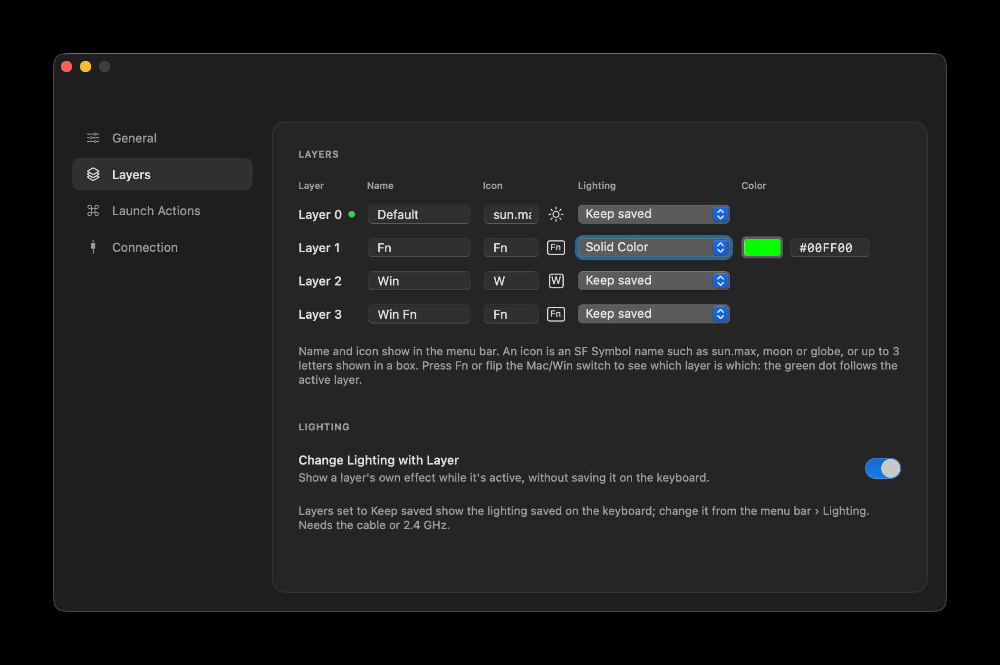
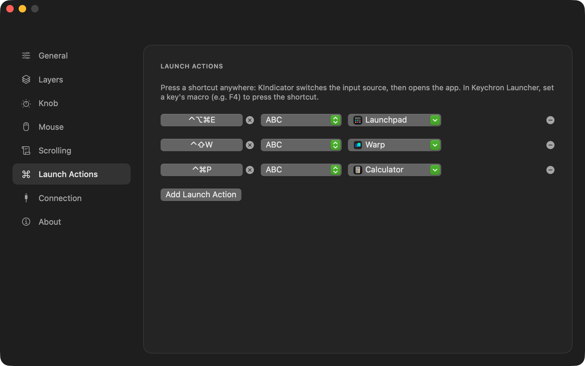
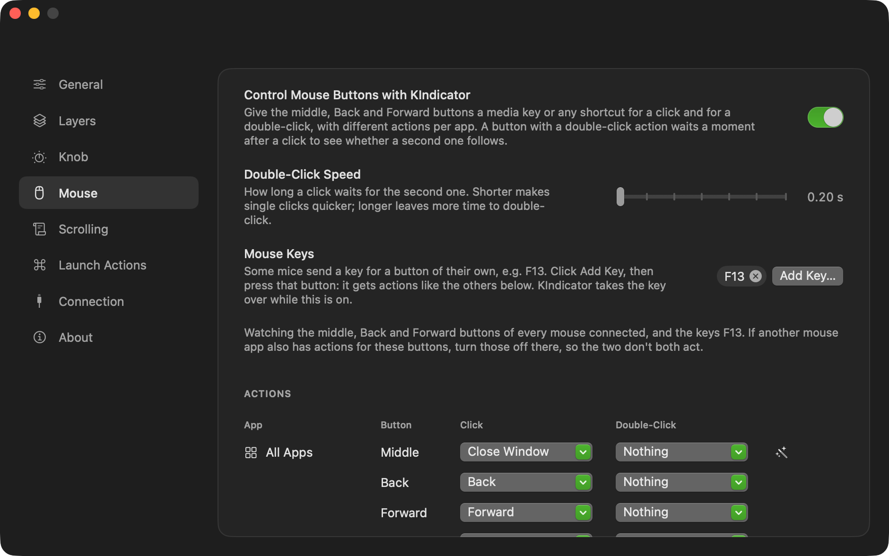

# KIndicator

**A macOS menu bar indicator for Keychron keyboards: see the active layer at a
glance, light the keyboard per layer, and launch apps in the right input language.**



Keychron's ZMK keyboards (like the V6 Ultra 8K) don't tell you which layer is on.
Hold Fn, lock a layer with a TG key or flip the Mac/Win switch, and you're guessing.
KIndicator reads the active layer from the keyboard and shows it in the menu bar.

[Download Latest Version 1.3.1](https://github.com/tkgreg/kindicactor/releases/tag/v1.3.1)

## Features

- **Active layer in the menu bar.** Each layer gets your own name and icon: an SF
  Symbol such as `sun.max`, or up to 3 letters in a box like **Fn** or **W**. Show
  the icon, the name, or both.
- **Lighting per layer.** Give a layer its own RGB effect and colour (pick one or
  type a hex value), so the keyboard itself shows which layer is on. Your saved
  lighting comes back when you return. Nothing is written to the keyboard's
  storage on each switch.
- **Lights off while the display sleeps.** Like a MacBook's keyboard backlight: the
  lights go off when the Mac's display sleeps and come back when it wakes. Nothing
  is saved on the keyboard.
- **Brightness follows the room.** On a MacBook or iMac, the keyboard dims in a dark
  room and brightens in a bright one, using the Mac's ambient light sensor. Set the
  brightness for each end; in between it changes gradually, fading rather than
  jumping. Nothing is saved on the keyboard.
- **Mic indicator.** While any app records from a microphone, a key of your choice
  pulses (or stays lit) in your colour, and gets its own colour back afterwards. Pick
  the key on a drawing of your keyboard that shows what each key does on the active
  layer. Works with the Per-key RGB effect; a layer set to Solid Color is drawn key by
  key meanwhile, so the key shows there too. Nothing is saved on the keyboard, and it
  needs no microphone permission.
- **Knob Control.** Turn and press the knob for volume, precise volume (quarter steps,
  as the volume keys do with ⌥⇧, speeding up while you spin the knob), tracks, display brightness or any shortcut, with
  different actions in different apps. Keychron Launcher can't put macros on the knob,
  so KIndicator sets it to send F18, F19 and F20 (on the layers you pick, saved on the
  keyboard) and turns those into your actions. Turning it off gives the knob its own
  keys back. Needs Accessibility permission, to press the keys.
- **Mouse buttons.** Give a mouse's middle, Back and Forward buttons a media key or any
  shortcut for a click and for a double-click, with different actions in different apps:
  e.g. Back and Forward as ⌘[ and ⌘] so they work in Safari, middle click to close a
  window, double-click Back to close a tab. A button the mouse sends as a key (many gaming
  mice send F13 and the like) gets actions too: e.g. F13 for Mission Control. A button with
  a double-click action waits a moment after a click (0.3 s, adjustable) to see whether a
  second one follows; the others act at once. Needs Accessibility permission.
- **Smooth scrolling.** A mouse wheel's notches glide like a trackpad's: set the
  distance per notch, the glide and how much faster a fast spin goes. It feels the same on
  a 60 Hz and a 120 Hz screen, scrolls exactly the distance asked, stops at once when the
  wheel turns back or you click, and leaves trackpads and the Magic Mouse alone. ⇧ scrolls
  sideways, a key of your choice scrolls faster, another (⌘) scrolls without smoothing so
  ⌘-scroll zooms as usual; apps of your choice keep the wheel's own scrolling. Needs
  Accessibility permission.
- **Lighting from the menu.** Switch the keyboard's effect (Breathing, Per-key RGB,
  Off, …) without opening Keychron Launcher.
- **Launch actions.** One global shortcut switches the input language, then opens
  an app. For example, switch to English, then open Launchpad, so typing to
  search always works even when Russian was selected. Put the shortcut on a
  keyboard key (e.g. F4) with a Keychron Launcher macro.
- **Command apps.** Make any shell command an app with its own window: htop, a dev
  server, an AI agent or a script of several lines. It's saved in `~/Applications`,
  so Spotlight, Launchpad and the Dock open it like any app, and a launch action puts
  it on a shortcut or a keyboard key. Give it an icon (an SF Symbol or letters on a
  colour), a starting folder and what happens when the command ends; the window's ⓘ
  button shows the exact command to copy. With Apple Intelligence, a Finder comment is
  written on the Mac from the name and command (htop gets *process, cpu, monitoring…*),
  so Spotlight finds the app by what it does; edit it as you like.
- **Keyboard info.** Model (also through the 2.4 GHz dongle), connection and
  firmware version.
- **Plays nice with Keychron Launcher.** Pauses automatically while Launcher is
  open, so the two apps don't confuse the keyboard.
- **Lightweight.** Starts at login, lives in the menu bar, needs no special
  permissions (no Input Monitoring; Accessibility only for Knob Control, mouse buttons
  and smooth scrolling; permission to control Finder only to set command apps'
  comments).





## Download

Get the latest `KIndicator-<version>.dmg` from
[Releases](https://github.com/tkgreg/kindicactor/releases/latest), open it and drag
**KIndicator** to **Applications**. The app is signed and notarized by Apple.

On first launch KIndicator adds itself to **System Settings › General › Login
Items**; you can turn that off in **Settings › General**.

**Requirements:** macOS 15 or later, Apple silicon or Intel.

## Getting started

1. Connect the keyboard with the **USB cable** or the **2.4 GHz dongle**.
2. Open **Settings › Layers** and press Fn or flip the Mac/Win switch: the green dot
   follows the active layer, so you can see which row is which. Give each layer a
   name and an icon.
3. Optional: pick a lighting effect for a layer, e.g. red *Solid Color* for the Fn
   layer.
4. Optional: in **Settings › Launch Actions** add a shortcut, then in Keychron
   Launcher set a key's macro to press it.
5. Optional: in **Settings › Knob** turn on Knob Control, allow KIndicator in
   **System Settings › Privacy & Security › Accessibility**, and pick what the knob does
   in all apps and in single apps.

## Compatibility

Tested with the **Keychron V6 Ultra 8K** (ANSI) on firmware 1.0.2. Other Keychron
boards running Keychron's ZMK firmware ("Ultra" / "8K" series) use the same
protocol and should work; their model name shows once they've been connected by
cable or Bluetooth.

| Connection | Layer | Lighting | Notes |
|---|---|---|---|
| USB cable | ✓ | ✓ | |
| 2.4 GHz dongle | ✓ | ✓ | Through the Keychron Ultra-Link 8K |
| Bluetooth | – | – | The firmware has no data channel over Bluetooth; KIndicator just shows that the keyboard is on Bluetooth |

### Limitations

- **KIndicator can't switch layers.** Keychron's firmware only reports the layer;
  use layer keys (MO, TG, TO) set in Keychron Launcher.
- **The `TT(layer)` keycode doesn't work on this firmware** (it does nothing; a
  Keychron bug). Use `MO(1)` on Fn plus `TG(1)` on another key instead.
- While Keychron Launcher is open, KIndicator is paused.

## Build from source

```bash
./build.sh --install     # build, sign (Developer ID, else Apple Development), install and launch
./release.sh             # universal build, Developer ID signing, notarized DMG in dist/
swift test               # tests of KIndicatorCore
```

`KIndicatorCore` holds the app's logic as pure functions, Foundation only: the keyboard
protocol, the lighting and mic-indicator decisions, layouts and keymaps. The `KIndicator`
app does the I/O (HID, Core Audio, settings) and the UI, and carries out what the core
decides. `CommandHost` is the terminal window inside every command app.

`release.sh` needs a *Developer ID Application* certificate and notarization
credentials stored with `xcrun notarytool store-credentials kindicator-notary`.

## How it works

Keychron's ZMK firmware exposes the same raw HID channel Keychron Launcher uses
(usage page `0xFF60`, usage `0x61`, 32-byte reports):

- `0xA3` returns the **highest active layer**, so momentary Fn layers show too.
  KIndicator asks every 250 ms by default (Settings › Connection).
- `0x07` / `0x08` / `0x09` on channel `3` set, get and save the RGB matrix effect,
  colour, brightness and speed. Per-layer lighting is applied without saving and
  the saved lighting is restored afterwards. Changes made with the keyboard's light
  keys in the meantime are kept.
- `0xA8 0x09` / `0xA8 0x0A` get and set the colours of up to 9 keys in Per-key RGB
  mode, as Keychron Launcher does. Launcher then saves with `0xA8 0x02`; KIndicator
  never does, so the mic indicator's colour stays in the keyboard's memory.
- VIA's `0x14` / `0x15` get and set what turning the knob sends on a layer, and `0x04` /
  `0x05` what a key sends (pressing the knob is a key of the matrix). Knob Control writes
  F18, F19 and F20 with them, which the keyboard saves as when set in Keychron Launcher,
  and writes the knob's own keys back when turned off.
- VIA's `0x12` reads the keymap, and `0xA8 0x06` the LED behind each key, for the
  keyboard drawing. Its layout comes from Keychron Launcher's definitions, bundled
  for the V6 Ultra 8K ANSI, ISO and JIS (`Tools/make-layouts.swift` regenerates them).
- `0xB2`, answered by the 2.4 GHz dongle, lists the paired keyboard's vendor and
  product ID, which gives the model name.
- The keyboard answers every app that has the channel open and drops a request
  that arrives while it's busy. So KIndicator goes quiet whenever another process
  (e.g. Keychron Launcher in a browser) has the channel open.

Launch actions use Carbon hotkeys and the Text Input Sources API, which need no
permissions. Knob Control listens for F18-F20 the same way, and presses media keys as
system-defined events (with ⌥⇧ for precise volume) and shortcuts as key events, which
macOS allows only with Accessibility permission. Mouse buttons use an event tap on the
middle, Back and Forward buttons: a click with an action runs it instead of reaching the
app; a press of a button with a double-click action is held back until the double-click
time runs out, then runs the click's action or is sent on as it was, and a second press
within it runs the double-click action instead. Keys a mouse sends for its own buttons are
caught as global hotkeys, like the knob's.

Smooth scrolling runs on a thread of its own, so a busy app never holds up scrolling: an
event tap takes each wheel notch (events that are continuous or carry phases, from
trackpads and the like, pass untouched), and each notch adds distance to a critically
damped spring, solved exactly over each frame's real time and timed by the display link
of the screen under the pointer. Fractions of a pixel carry over, so every notch scrolls
exactly its distance; each frame is posted as a fresh continuous pixel event. The mic indicator asks Core Audio which processes are recording
(`kAudioProcessPropertyIsRunningInput`); it records nothing, so it needs no
microphone permission either. Room brightness reads the ambient light sensor once a
second through IOKit's HID event system (falling back to the sensor's `CurrentLux` in
the IORegistry), takes the median of the last 5 readings and follows only changes of
1.5× or more, so a passing shadow or a wobbling lamp doesn't make the keyboard flicker.

A command app is a bundle in `~/Applications` that KIndicator writes: a copy of
`CommandHost` (a [SwiftTerm](https://github.com/migueldeicaza/SwiftTerm) terminal),
signed ad-hoc on the Mac, with the command and settings in its `Info.plist`. The bundles
are the only record, so one thrown away in the Finder is gone from the list too.
`CommandHost` runs the command with the user's shell as a login and interactive shell
(`zsh -l -i -c …`), as Terminal does, so the PATH from `.zprofile` and `.zshrc` (Homebrew,
nvm) works. The Finder comment comes from Foundation Models' on-device
`SystemLanguageModel`, never Private Cloud Compute. It's stored as the
`kMDItemFinderComment` attribute, which Spotlight indexes, and set through Finder too,
since Get Info reads comments from the folder's `.DS_Store`.

The app icon is generated by `Tools/make-icon.swift`:

```bash
swift Tools/make-icon.swift Resources/AppIcon.icns
```

Logs:

```bash
log stream --predicate 'subsystem == "local.kindicator"'
```

## License

[MIT](LICENSE). Command apps include [SwiftTerm](https://github.com/migueldeicaza/SwiftTerm)
(MIT); see [THIRD-PARTY-NOTICES](Resources/THIRD-PARTY-NOTICES).
